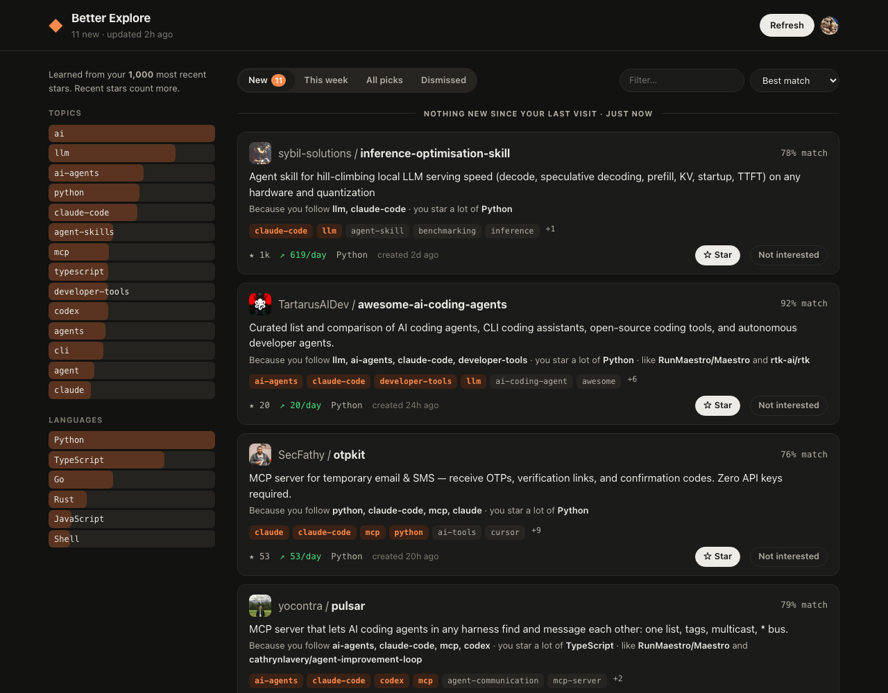

# Better GitHub Explore

A personal discovery feed for GitHub, ranked by what you've starred.



It reads your most recent stars, builds a weighted taste profile (topics, languages, keywords; recent stars count more), searches GitHub for fresh repos in those areas, and ranks them by fit and momentum (stars per day). Spam clones, archived repos, your own repos and unpopular forks are filtered out.

It runs in two ways from the same page in `public/`.

## Hosted (GitHub Pages)

Open the page and enter a GitHub username. The browser reads that account's public stars straight from GitHub's API and keeps the feed, dismissed repos and last visit in `localStorage`. Nothing else is stored or sent anywhere.

Without a token, GitHub allows 60 API requests an hour and 10 searches a minute per visitor, so a refresh takes about 2 minutes. Picks appear as they're found. Starring opens the repo on GitHub.

To publish: push to `main`, then in the repo's **Settings → Pages** set **Source** to **GitHub Actions**. `.github/workflows/pages.yml` runs the tests and deploys `public/`.

## Local (your own token)

Needs Node 20+ and a GitHub login (`gh auth login`) or a `GITHUB_TOKEN`.

```sh
npm start        # http://localhost:4321
npm test
```

The server serves the same page plus a small proxy that adds your token to GitHub requests. This gives you private stars, starring from the feed, and a refresh in under a minute. The token stays on the server. The proxy only allows the calls the app makes, and only on localhost. The feed refreshes when you open the page and it is older than 6 hours. If you have a `data/state.json` from an earlier version, its feed and dismissed repos are carried over the first time you open the page.

## Settings (local mode, environment variables)

| Variable | Default | Meaning |
| --- | --- | --- |
| `PORT` | `4321` | Port to listen on |
| `STAR_LIMIT` | `1000` | How many recent stars to learn from |
| `REFRESH_HOURS` | `6` | Hours between automatic refreshes |
| `FORK_MIN_STARS` | `200` | Forks below this are hidden |
